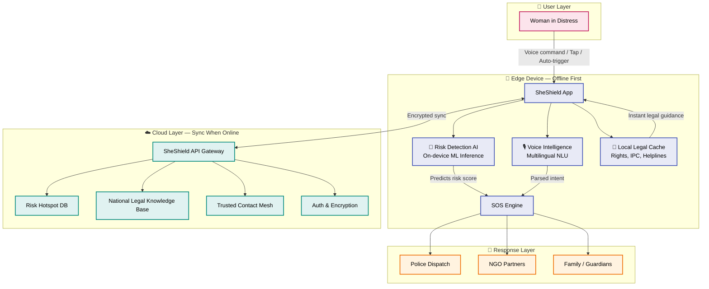

# 🛡️ SheShield — The AI Guardian

> _"Every woman deserves to walk free — not just fearless, but protected."_

[](https://opensource.org/licenses/MIT)
[](#)
[](#)
[](#)
[](#)
[](./CONTRIBUTING.md)

**A predictive AI-driven safety infrastructure for women** — integrating **Risk Detection AI**, **local-language Voice Intelligence**, and **offline-first legal support** into a single, guardian-grade ecosystem that works even when connectivity doesn't.

---

## 🔥 The Problem We refuse to Look Away From

In India alone, a woman is reported unsafe every **9 minutes**. Yet most safety apps fail her precisely when she needs them most — dead batteries, no internet, language barriers, and reactive (not predictive) alerts. SheShield exists to flip the script: **from panic-button after the fact, to a silent guardian before the threat.**

---

## ✨ Key Pillars

### 🧠 1. Risk Detection AI
A predictive engine that fuses geolocation, motion, audio cues, and historical hotspot data to **forecast risk before it escalates**. Powered by lightweight ML models that run on-device — no cloud round-trip, no leaks.

### 🎙️ 2. Voice Intelligence (Local Languages)
Speak. Don't type. SheShield understands **Hindi, Tamil, Telugu, Bengali, Marathi & more** — natural voice commands like _"Help me, I'm at the bus stand"_ trigger instant SOS, location sharing, and trusted-contact escalation. Built for the 90% of India that doesn't think in English.

### ⚖️ 3. Offline-First Legal Support
A pocket lawyer that never sleeps — and never needs signal. Critical legal rights, IPC sections, nearest police stations, women's helplines, and step-by-step FIR guidance cached **locally**. Syncs with national databases when connectivity returns.

---

## 🏗️ System Architecture



The architecture is deliberately **edge-heavy** — the three AI pillars (Risk Detection, Voice Intelligence, Legal Support) all run locally so the user is never abandoned at the moment of crisis. The cloud layer only enriches: hotspot mapping, legal updates, and trusted-contact orchestration.

---

## 🚶 User Journey — From Threat to Safety

```mermaid
flowchart LR
    A([👩 Woman senses risk]) --> B{Voice command?}
    B -->|Yes| C[🎙️ Multilingual NLU<br/>parses intent & location]
    B -->|No tap, auto-trigger| D[🧠 Risk AI detects<br/>anomaly pattern]
    C --> E[SOS Engine Activated]
    D --> E
    E --> F[Risk Score Computed]
    F --> G{High risk?}
    G -->|Yes| H[🚨 Alert Trusted Contacts<br/>+ Police + NGO]
    G -->|Moderate| I[📱 Silent Track<br/>+ Pre-warn contacts]
    H --> J[⚖️ Offline Legal Guidance<br/>Pushed to screen]
    I --> J
    J --> K([🛡️ Woman Reaches Safety])

    classDef start fill:#fce4ec,stroke:#c2185b,stroke-width:2px,color:#000
    classDef decide fill:#fff8e1,stroke:#f9a825,stroke-width:2px,color:#000
    classDef action fill:#e3f2fd,stroke:#1976d2,stroke-width:2px,color:#000
    classDef end fill:#e8f5e9,stroke:#2e7d32,stroke-width:2px,color:#000

    class A,K start
    class B,G decide
    class C,D,E,F,H,I,J action
```

Every path converges on one outcome: **the woman reaches safety with legal empowerment in her hand** — signal or no signal.

---

## 🧰 Tech Stack

| Layer | Technology |
|---|---|
| **Risk Detection AI** | Python · PyTorch · scikit-learn · TensorFlow Lite (on-device) |
| **Voice Intelligence** | Whisper (multilingual ASR) · fine-tuned IndicBERT · gTTS fallback |
| **Legal Knowledge Base** | SQLite local cache · FAISS semantic search · LangChain RAG |
| **App Layer** | Flutter / React Native (cross-platform, lightweight) |
| **Backend API** | FastAPI · PostgreSQL · Redis |
| **Security** | End-to-end AES-256 · JWT auth · anonymized telemetry |

---

## 🚀 Quick Start

```bash
# Clone the guardian
git clone https://github.com/reenuasrin2008/SheShield-The-AI-Guardian.git
cd SheShield-The-AI-Guardian

# Create environment
python -m venv venv && source venv/bin/activate
pip install -r requirements.txt

# Initialize local legal cache (offline-first!)
python scripts/seed_legal_db.py

# Launch the API
uvicorn app.main:app --reload --host 0.0.0.0 --port 8000
```

---

## 📂 Project Structure

```
SheShield-The-AI-Guardian/
├── app/                  # FastAPI backend
│   ├── main.py
│   ├── api/
│   └── core/
├── risk_ai/              # Risk detection ML models
├── voice/                # Multilingual NLU modules
├── legal/                # Offline legal cache & RAG
├── mobile/               # Flutter / RN app shell
├── scripts/              # Setup & seed scripts
└── docs/                 # Architecture deep-dives
```

---

## 🗺️ Roadmap

- ✅ **Phase 1** — Vision, architecture & core ML pipeline design
- 🚧 **Phase 2** — Risk Detection AI v0.1 + multilingual voice intent parser
- 🔜 **Phase 3** — Offline legal cache with 5 state jurisdictions
- 🔜 **Phase 4** — Field pilot with partner NGOs (target: 1,000 women)
- 🌍 **Phase 5** — Pan-India launch + open API for integrators

---

## 🤝 Contributing

SheShield is mission-driven and open by design. Whether you bring ML chops, Indic-language NLP skills, legal domain knowledge, or field-testing capacity — **there is a role for you**.

1. Fork the repo
2. Create a branch: `git checkout -b feature/your-idea`
3. Commit with clear messages
4. Open a PR — describe the impact on women's safety

See [`CONTRIBUTING.md`](./CONTRIBUTING.md) for guidelines and our code of conduct.

---

## 📜 License

Released under the **MIT License** — because safety tech should be free to build upon. See [`LICENSE`](./LICENSE).

---

## 💜 Why SheShield?

Because the next 9 minutes belong to her — not to fate. SheShield isn't another panic button; it's a **predictive guardian** that speaks her language, knows her rights, and stands between her and harm — **even when the signal dies**.

> _Built with urgency. Open by principle. Guarded by AI._

**⭐ Star this repo if the mission resonates.**
